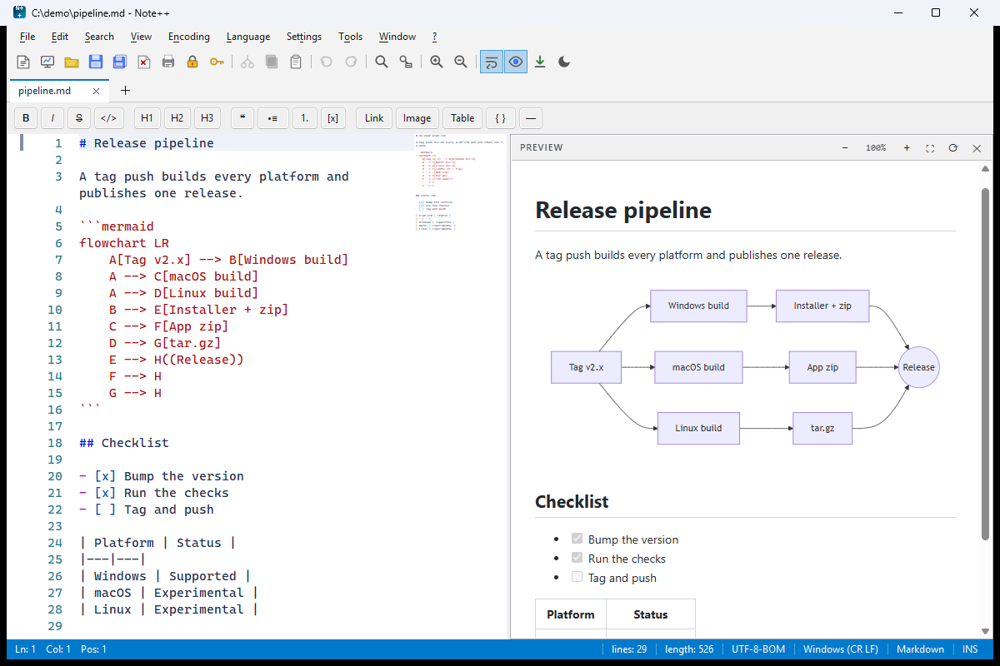
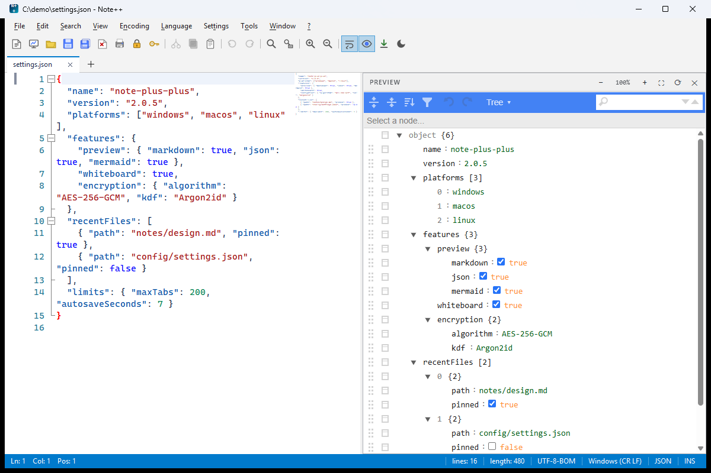
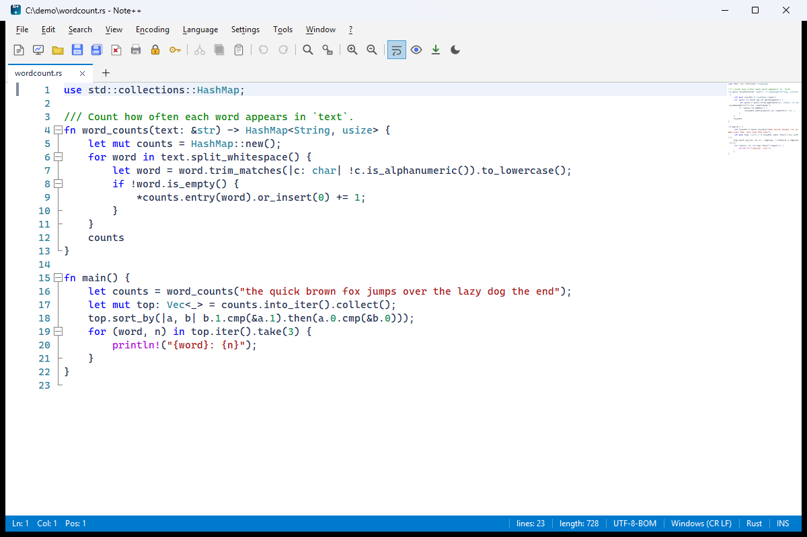
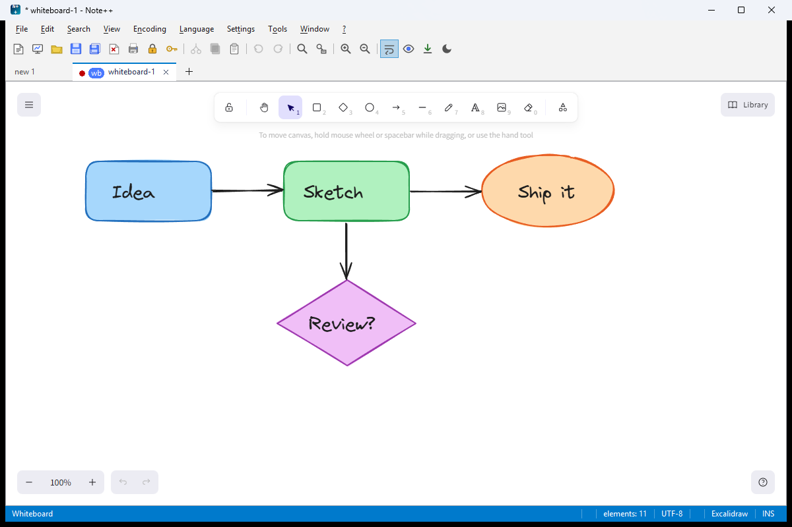

<div align="center">

# Note++

### A fast, developer-focused text editor

*Written in Rust on the Scintilla editing engine. Familiar, quick editing, with live previews, a whiteboard, encrypted files, an HTTP scratchpad and a Bitwarden-backed password inserter built in. Now for Windows, macOS and Linux.*

[](https://github.com/YogeshPraj/Note-/releases/latest)
[](https://github.com/YogeshPraj/Note-/releases)
[](https://github.com/YogeshPraj/Note-/releases/latest)
[](https://github.com/YogeshPraj/Note-/actions/workflows/build.yml)
[](#license)

[**Download**](#download) • [Features](#features) • [Build from source](#build-from-source) • [Releases](#releases) • [Report a bug](https://github.com/YogeshPraj/Note-/issues/new?labels=bug&title=%5BBug%5D%20) • [Request a feature](https://github.com/YogeshPraj/Note-/issues/new?labels=enhancement&title=%5BFeature%5D%20)

</div>

---

## Screenshots

<table>
  <tr>
    <td width="50%"><a href="docs/screenshots/markdown-mermaid.png"></a><br><sub><b>Markdown + Mermaid</b>: live preview that scrolls with the editor.</sub></td>
    <td width="50%"><a href="docs/screenshots/json-preview.png"></a><br><sub><b>JSON</b>: an editable tree view next to the text.</sub></td>
  </tr>
  <tr>
    <td width="50%"><a href="docs/screenshots/editing.png"></a><br><sub><b>Editing</b>: syntax highlighting, folding, line numbers and a minimap.</sub></td>
    <td width="50%"><a href="docs/screenshots/whiteboard.png"></a><br><sub><b>Whiteboard</b>: sketch in a tab; it is saved with your session.</sub></td>
  </tr>
</table>

## About

**Note++ 2.0** is a native desktop editor: quick to start, light on memory, and familiar from the first minute. The editing core is [Scintilla](https://www.scintilla.org/) with [Lexilla](https://www.scintilla.org/Lexilla.html) lexers, kept separate from the platform layer (`crates/core` is portable; one wxWidgets shell in `wx/` targets Windows, macOS and Linux behind a `Platform` trait). Menus, tabs and dialogs are native, with previews, the whiteboard and the compare view in the system WebView.

**Platforms:** Windows 10/11 (64-bit), macOS (Apple Silicon) and Linux (64-bit). Windows is the tested, supported build. The macOS and Linux builds are new in 2.0.2 and **experimental**: they are built from the same code but have had far less testing, so expect rough edges and please [report them](https://github.com/YogeshPraj/Note-/issues/new).

Version 2.0 replaces the earlier 1.x line. It keeps the same data folder (`%APPDATA%\notepp`), so open tabs, unsaved text, settings and the encryption profile carry over on the first start.

## Download

| Platform | Download | Status |
|---|---|---|
| **Windows 10/11** (64-bit) | [Installer (`NotePP-Setup-<version>.exe`)](https://github.com/YogeshPraj/Note-/releases/latest) · [Portable zip](https://github.com/YogeshPraj/Note-/releases/latest/download/NotePP-windows-x64.zip) | Supported |
| **macOS** 11+ (Apple Silicon) | [`NotePP-macos-arm64.zip`](https://github.com/YogeshPraj/Note-/releases/latest/download/NotePP-macos-arm64.zip) | Experimental |
| **Linux** (x86-64, GTK 3) | [`NotePP-linux-x64.tar.gz`](https://github.com/YogeshPraj/Note-/releases/latest/download/NotePP-linux-x64.tar.gz) | Experimental |

All files are on the [latest release page](https://github.com/YogeshPraj/Note-/releases/latest), each with a `.sha256` checksum. The macOS and Linux files are attached after their build finishes; if one is missing from a release, that build failed, and you can [build from source](#build-from-source) instead. Intel Macs and Linux on ARM have no download yet.

## Features

### Editing
- Multi-tab editing with syntax highlighting for dozens of languages (Language menu), code folding, bookmarks, word wrap, minimap, indent guides and whitespace/EOL symbols.
- Find, Replace, Mark and Find in Files with a results panel; incremental search; regular expressions.
- Encodings the traditional way: *Encode in* / *Convert to*, ANSI code pages, UTF-8 (with or without BOM), UTF-16; line endings (CRLF / LF / CR).
- Sessions: tabs and unsaved text survive restarts and crashes; Load / Save Session; Recent Files.
- Familiar default shortcuts, a **Shortcut Mapper**, a **Style Configurator** with built-in themes (Monokai, Dracula, Solarized and more), light and dark mode, and an editor for the right-click menu.
- Command Palette (`Ctrl+Shift+P`), Quick Open (`Ctrl+P`), Print Preview, Page Setup, distraction-free mode.
- Tabs you can pin and colour, with Close All / Close Others / Reveal in File Tree / Copy Full Path from the right-click menu.
- Folder as Workspace tree with a one-click close button.
- **Pictures**: copy an image anywhere and press `Ctrl+V` in the editor: it opens in a new tab with an icon bar on the left (select, rectangle, ellipse, line, arrow, freehand, text, speech bubble, numbered step label, highlight, hide by pixelating, crop, rotate, flip, resize). Annotations stay editable objects until you save: move, resize, restyle or delete them; undo and redo, copy and save as PNG. PNG, JPEG, GIF, BMP and WebP files open the same way.

### Previews
- **Markdown** and **HTML** live preview (`Ctrl+Shift+V`), with Mermaid diagrams rendered inside Markdown, syntax-coloured code blocks, math (`$x^2$` and `$$…$$`), GitHub alerts (`> [!NOTE]`), heading anchors, and Copy buttons on tables, code and diagrams (diagrams also zoom and copy as a picture).
- **JSON** tree view and editor; **Mermaid** (`.mmd`) diagram preview.
- **Log Follow** mode for `.log` / `.out` / `.err`: live tail with level filters (ERROR / WARN / INFO / DEBUG), text or regex search, stack traces kept with their line.

### Tools
- **Compare**: two files, or a file against the clipboard, with a side-by-side diff.
- **Whiteboard**: a hand-drawn canvas (Excalidraw) in its own tab; saved as JSON.
- **Encrypted pad**: per-file AES-256-GCM encryption with a password and a recovery key.
- **HTTP scratchpad**: write requests in a `.http` file and send them with `Ctrl+Enter`.
- **Passwords**: insert secrets from your Bitwarden vault (through the official Bitwarden CLI) without copying them to the clipboard.
- Text tools: hashes (MD5, SHA-1, SHA-256, ...), Base64, case conversion, sort, line operations.

### Updates
- **Windows updates itself.** A few seconds after start (and every few hours) Note++ checks GitHub for a newer release, downloads it in the background and says so in the status bar: it is installed the next time you start Note++, with your tabs and any files you opened still there. A green toolbar notice lets you install it right away instead. Updates are signed: a download is used only when its signature and SHA-256 check out. Turn it off under *Settings > General* or *? > Update Automatically*. macOS and Linux builds do not update themselves; *Check for Updates* opens the releases page.

## Install

### Windows

Download **`NotePP-Setup-<version>.exe`** from [Releases](https://github.com/YogeshPraj/Note-/releases/latest) and run it. It installs for the current user (no administrator rights needed), adds Start-menu and desktop shortcuts, lists Note++ under *Open with* and adds *Edit with Note++* to the Explorer menu. An installed 1.x release is replaced automatically.

Prefer no installer? `NotePP-windows-x64.zip` is the same app as a plain folder: unzip it anywhere and run `notepp.exe`.

Requires Windows 10 or 11 (64-bit) with the WebView2 runtime, which ships with Windows 11 and current Windows 10. Data is kept in `%APPDATA%\notepp`.

### macOS (experimental)

Unzip `NotePP-macos-arm64.zip` and drag **Note++.app** to Applications. The app is not signed or notarised, so macOS will refuse the first start: right-click the app and choose *Open*, or run `xattr -dr com.apple.quarantine /Applications/Note++.app`. Data is kept in `~/.config/notepp`.

### Linux (experimental)

```sh
tar xzf NotePP-linux-x64.tar.gz
./NotePP/notepp
```

Needs GTK 3 and WebKitGTK 4.1 (Ubuntu/Debian: `sudo apt install libgtk-3-0 libwebkit2gtk-4.1-0`). Previews and the whiteboard need WebKitGTK. Data is kept in `~/.config/notepp`.

Updates: Windows installs update themselves (see Updates above). On macOS and Linux, *Check for Updates* opens the releases page.

## Build from source

The portable core (`crates/core`) builds and tests anywhere: `cargo test`. The app is the wxWidgets shell in `wx/`, a separate Cargo workspace. wxWidgets itself is built from source the first time (10 to 20 minutes, then cached).

First, on every system, fetch the web assets the repository does not store (Node.js 18+; Mermaid and Excalidraw are built from `old-src/`):

```sh
node scripts/setup-assets.js
```

**Windows**: [Rust](https://rustup.rs/) with the `stable-x86_64-pc-windows-gnu` toolchain (pinned in `rust-toolchain.toml`), MinGW-w64 with the UCRT runtime including CMake and Ninja (`winget install BrechtSanders.WinLibs.POSIX.UCRT`), and LLVM for `libclang`. See [`wx/README.md`](wx/README.md) for the environment variables.

```powershell
cd wx
cargo run -p notepp-wx
```

**Linux** (Debian/Ubuntu):

```sh
sudo apt install build-essential cmake ninja-build pkg-config libclang-dev libgtk-3-dev libwebkit2gtk-4.1-dev libgl1-mesa-dev libglu1-mesa-dev libxkbcommon-dev libx11-dev
cd wx && RUSTUP_TOOLCHAIN=stable cargo run -p notepp-wx
```

**macOS**: Xcode command-line tools and `brew install cmake ninja`, then `cd wx && RUSTUP_TOOLCHAIN=stable cargo run -p notepp-wx`. (`RUSTUP_TOOLCHAIN=stable` overrides the Windows toolchain pinned in the repository.)

Native crashes on Windows are written to `%APPDATA%\notepp\crash.log`.

## Releases

Every push and pull request is built and tested by GitHub Actions ([`build.yml`](.github/workflows/build.yml)). Pushing a tag `vX.Y.Z` that matches the version in `Cargo.toml` publishes a GitHub release:

- Windows (built first, publishes the release): `NotePP-Setup-X.Y.Z.exe` (installer, NSIS), `NotePP-windows-x64.zip` and its `.sha256` (portable folder; the in-app updater reads this pair), and `latest.yml` (manifest for the 1.x updater).
- macOS and Linux (experimental, added when their build succeeds): `NotePP-macos-arm64.zip` and `NotePP-linux-x64.tar.gz`, each with a `.sha256`.

To build the Windows files locally (after the setup above):

```powershell
powershell -File scripts\package.ps1    # builds dist\NotePP
powershell -File scripts\release.ps1    # dist\release\NotePP-windows-x64.zip + .sha256
powershell -File scripts\installer.ps1  # dist\release\NotePP-Setup-X.Y.Z.exe + latest.yml (needs NSIS: winget install NSIS.NSIS)
```

On macOS or Linux, after `cargo build -p notepp-wx --release` in `wx/`: `bash scripts/package-unix.sh macos-arm64` (or `linux-x64`).
## Project layout

```
crates/core/     portable logic (its own crate): tabs, sessions, encodings, search, crypto, updater
wx/              the wxWidgets shell: window, menus, tab strip, dialogs, WebView panes (see wx/README.md)
vendor/          patched wxdragon-sys glue
assets/          icons, preview pages, bundled Mermaid / jsoneditor / whiteboard
installer/       the NSIS installer script and its sidebar image
scripts/         asset setup, package, release and installer scripts, CI checks
tests/           fixtures
old-src/         the previous 1.x project, kept for reference and as the source of the bundled web assets
```

Gotchas worth knowing when working on the editor core:
- `SCI_SETPROPERTY` (e.g. `fold`) is forwarded to the lexer; set it *after* `SCI_SETILEXER` or it is dropped.
- Lexilla lexers number their styles independently, so each language needs its own palette.

## Security

- The executable only loads DLLs from `System32` and its own folder.
- Document previews do not fetch images from the web unless you turn that on in the settings.
- Updates are downloaded over HTTPS and verified against a SHA-256 checksum before they are unpacked. The checksum catches damaged or swapped files; it is not a code signature, because releases are not signed yet.
- Encrypted files use AES-256-GCM with keys derived from your password (PBKDF2); unsaved text of an encrypted tab is never written to the session file as plain text.

If you find a vulnerability, please open a private security advisory on GitHub rather than a public issue.

## License

MIT. Scintilla and Lexilla are by Neil Hodgson and are used under the HPND license. The preview also bundles [highlight.js](https://highlightjs.org/) (BSD-3-Clause), [KaTeX](https://katex.org/) (MIT), [Mermaid](https://mermaid.js.org/) (MIT) and [JSON Editor](https://github.com/josdejong/jsoneditor) (Apache-2.0).

---

<div align="center">

Created by [**Yogesh Prajapati**](https://github.com/YogeshPraj)

[Report a bug](https://github.com/YogeshPraj/Note-/issues) • [Request a feature](https://github.com/YogeshPraj/Note-/issues) • [Releases](https://github.com/YogeshPraj/Note-/releases)

</div>
